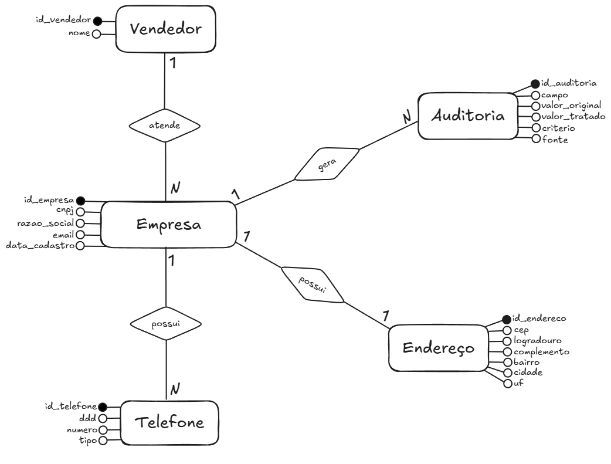

# Projeto-Primora

## Execução do ETL

Configure `DB_USER`, `DB_PASSWORD`, `DB_NAME` e `DB_HOST` no arquivo `.env` (e
`DB_PORT` se o PostgreSQL não usar a porta padrão). Com as tabelas do banco já
criadas, execute:

```bash
npm run etl
```

O processo lê `ETL/data/clientes_distribuidora_vetor.csv`, normaliza os dados e
grava empresas, vendedores, telefones e endereços em uma única transação. As
empresas existentes são atualizadas quando o ETL é executado novamente.


**Visão Geral**

**Estrutura do Projeto**

```text
├── API/                             # Camada de servidor web e entrega de dados
│   ├── public/                      # Arquivos estáticos do front-end
│   │   └── index.html               # Interface web para consulta dos dados
│   ├── db.js                        # Configuração e conexão com o banco de dados
│   └── server.js                    # Inicialização do servidor e rotas da API
├── ETL/                             # Pipeline de Extração, Transformação e Carga
│   ├── data/                        # Armazenamento de dados brutos ou processados
│   ├── test/                        # Testes
│   │   ├── Viacep.test.js           # Testes unitários da integração com o ViaCEP
│   │   └── transform.test.js        # Testes unitários das regras de transformação
│   ├── extract.js                   # Extração dos dados de origem
│   ├── index.js                     # Orquestrador que executa o fluxo completo de ETL
│   ├── load.js                      # Inserção dos dados tratados no banco de dados
│   ├── transform.js                 # Limpeza, padronização e enriquecimento dos dados
│   └── viacep.js                    # Consulta de endereços na API pública do ViaCEP
├── MER/                             # Documentação visual do banco de dados
│   ├── MER.png                      # Imagem do Modelo Entidade-Relacionamento
│   └── mer_conceitual.excalidraw    # Arquivo editável do diagrama no Excalidraw
├── sql/                             # Scripts de banco de dados
│   └── Empresa.Primora.sql          # Script SQL para criação das tabelas e estrutura
├── .gitignore                       # Arquivos ignorados pelo controle de versão (Git)
├── README.md                        # Documentação geral e guia de uso do projeto
├── package-lock.json                # Trava das versões exatas das dependências
└── package.json                     # Metadados, scripts e dependências do Node.js
```

**Documentação da API**

**Rotas da aplicação
Método	Rota	Descrição	Autenticação
GET	/api/users	Lista todos os usuários	Sim
GET	/api/users/:id	Busca um usuário pelo ID	Sim
POST	/api/users	Cadastra um novo usuário	Sim
PUT	/api/users/:id	Atualiza os dados de um usuário	Sim
DELETE	/api/users/:id	Remove um usuário	Sim


**Diagrama de Banco de Dados**


**Configurações do Ambiente**
